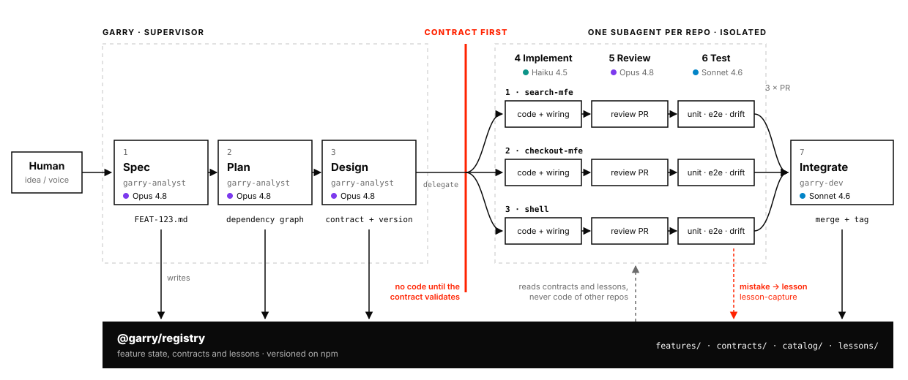

<p align="center">
  <picture>
    <source media="(prefers-color-scheme: dark)" srcset="assets/garry-logo-dark.svg" />
    
  </picture>
</p>

<p align="center">
  <a href="https://github.com/piotrgodycki/garry/actions/workflows/ci.yml"></a>
  <a href="./LICENSE"></a>
  =22" />
  
  
  
  
</p>

# Garry

Garry is a single supervisor agent that a human talks to. It drives each feature
through the full AI software development lifecycle and delegates every stage to
specialized subagents, one per repository, while a Contract Registry keeps the
services aware of each other. The starting point is microfrontends (React 19 with
Vite and Module Federation). The longer term target is any microservice, each with
its own repository, database and stack.

See [ARCHITECTURE.md](./ARCHITECTURE.md) for the full design.

## How Garry works

<p align="center">
  <picture>
    <source media="(prefers-color-scheme: dark)" srcset="assets/garry-sdlc-dark.svg" />
    
  </picture>
</p>

- **Spec, Plan, Design (supervisor).** Garry works on the Contract Registry itself:
  the feature document, the dependency graph and the contract change with a
  version bump.
- **Contract first gate.** Nobody touches code until the contract is updated and
  validated.
- **Implement, Review, Test (one subagent per repository).** Garry calls
  `delegate(repo, task, skills)` for each service on the shared `feat/<FEAT-id>`
  branch, in dependency graph order. A subagent reads only its slice of the
  contracts and the project lessons in `.garry/`, never the code of other repos.
- **Integrate.** The pull requests merge as one release with a version tag.
- **Learning from mistakes.** Review findings, failed tests, red CI, drift and human
  corrections become lessons in `lessons/` and are injected into later tasks.
- The agent and model per stage come from `garry.routing.json`. The feature state
  lives in `features/FEAT-x.md`, not in the memory of any agent.

## Packages

| Package | Role |
|---|---|
| `garry-registry` (`@garry/registry`) | Contract Registry: zod schemas and validation for cross service contracts |
| `garry-skills` (`@garry/skills`) | atomic, reusable agent capabilities per SDLC stage |
| `garry-tool` | the `garry` CLI plus the HTTP server (REST and SSE) |
| `garry-ui` | Next.js dashboard that consumes the server |

The packages are a pnpm workspace, colocated for now and split into separate
repositories when they are published. This repo uses **pnpm only**.

## Quick start

```bash
pnpm install
pnpm dev
```

`pnpm dev` starts the whole app: the server on http://localhost:8123 and the UI
on http://localhost:3000. Open the UI and pick a feature to watch its pipeline.

## Learning from mistakes

Garry learns in every project. Each mistake (a review finding, a failed test, a red
CI run, a drift or a human correction) becomes a lesson in the project's registry,
`lessons/L-xxx-*.md`, with one rule and every incident. The supervisor injects the
matching lessons into each task of the plan, and `garry sync` writes them into
`.garry/lessons.md` in each repository. A lesson that keeps happening is flagged as
a candidate for `@garry/skills`, so every project can get it after a human review.
See section 8 of [ARCHITECTURE.md](./ARCHITECTURE.md).

## Use from a phone or tablet

The UI works on phones and tablets (a bottom tab bar on phones, full screen voice
dock) and can be installed like an app: open it in the phone browser and choose
**Add to Home Screen**. Garry runs on your computer; the phone is a remote control.

The server is safe by default: it listens on `127.0.0.1` only, so nothing else can
reach it. Pick one of three ways to open it from another device.

### 1. Same Wi-Fi, with an access token (no extra software)

```bash
cp .env.example .env
# in .env: GARRY_ACCESS_TOKEN=<output of: openssl rand -hex 24>
#          GARRY_HOST=0.0.0.0
pnpm start        # production build of the UI plus the server
```

The server prints a sign-in link for each network address, for example
`http://192.168.1.20:3000/#garry-token=...`. Open it on the phone once: the UI stores
the token in that browser and removes it from the address bar. Every `/api` request
then carries the token; without it the server answers 401 and the UI asks for it.
The server refuses to listen on a network address without a token of at least 24
characters.

On plain HTTP the phone browser blocks the microphone, so the voice dock falls back
to typing. For voice, use option 2 or 3, which give you HTTPS.

### 2. A private network: Tailscale (or Headscale, NetBird, ZeroTier)

Only devices signed in to your private network can reach Garry, and Tailscale Serve
adds HTTPS. With Tailscale on the computer and the phone, and HTTPS certificates
enabled for the tailnet:

```bash
pnpm dev          # or pnpm start
pnpm phone        # tailscale serve: / to the UI, /api to the server
pnpm phone:off    # stop sharing
```

Open the printed `https://<machine>.<tailnet>.ts.net` address. The server stays on
`127.0.0.1` behind it. Setting `GARRY_ACCESS_TOKEN` as well is recommended. Do not
use `tailscale funnel`, which would publish Garry to the internet.

### 3. An identity aware tunnel: Cloudflare Tunnel with Access (or similar)

For access without an app on the phone, or for a team: a tunnel publishes Garry on
your own domain with HTTPS, and the access policy asks for a login (Google, GitHub,
an email code) before any request reaches your machine. Route `/` to `localhost:3000`
and `/api` to `localhost:8123`, keep `GARRY_ACCESS_TOKEN` set, and add your domain to
`GARRY_DEV_ORIGINS` if you run `pnpm dev` instead of `pnpm start`. Pomerium,
oauth2-proxy or Authentik in front of a reverse proxy work the same way.

Behind any proxy the UI finds the API on its own origin (`garry-ui/app/lib/api.ts`),
so `/` and `/api` only need to share one address. Hold Space push to talk needs a
keyboard; on a phone tap the orb or the mic button.

## Commands

| Command | What it does |
|---|---|
| `pnpm dev` | start the server and the UI together |
| `pnpm serve` | server only, on :8123 |
| `pnpm ui` | UI only, on :3000 (needs the server) |
| `pnpm start` | production build of the UI plus the server (faster on a phone) |
| `pnpm phone` | share the running app on your tailnet over HTTPS (Tailscale Serve, optional) |
| `pnpm phone:off` | stop sharing on the tailnet |
| `pnpm scaffold` | the interactive scaffolding wizard |
| `pnpm garry lessons` | list what Garry learned in this project |
| `pnpm garry lessons add ...` | record a mistake (see `--help`) |
| `pnpm -r typecheck` | type check every package |
| `pnpm -C garry-registry validate` | validate the sample registry |
| `pnpm -C garry-skills validate` | validate the skills manifest |

## Continuous integration

CI lives in [`.github/workflows/ci.yml`](./.github/workflows/ci.yml) and runs on
every push and pull request. It has three jobs:

- `validate`: `pnpm install --frozen-lockfile`, then `pnpm -C <pkg> typecheck` for the
  tool packages and `pnpm -C garry-registry` validation of the mfe and backend samples
  plus `pnpm -C garry-skills validate`.
- `dash-guard`: runs `scripts/check-no-emdash.mjs`. The build fails if any em dash,
  en dash, figure dash or horizontal bar appears in tracked text files.
- `security`: the security review. It runs `pnpm audit` (fails on a high or critical
  advisory) across the workspace and a Semgrep static analysis scan, which runs fully
  inside the job and needs no token.

CodeQL code scanning lives in [`.github/workflows/codeql.yml`](./.github/workflows/codeql.yml).
It is free on a public repository and runs on pushes to `main`, on pull requests and
weekly; the job skips itself while the repository is private.

### CI budget

The pipeline is kept cheap on purpose:

- Runner: `ubuntu-latest` only (Linux bills at the base 1x minute rate; macOS and
  Windows cost 10x and 2x and are avoided).
- Concurrency: `cancel-in-progress` stops superseded runs on the same ref, so a new
  push does not pay for a stale run.
- Caching: the pnpm store is cached, so installs stay fast.
- Node 22 and pnpm 10, a single version each.
- Rough cost per run: a few minutes total, which stays well inside the GitHub Actions
  free tier (2000 minutes per month on a private repository, unlimited on a public one).
- Dependabot version updates are off for now (pre MVP); `pnpm audit` covers dependency
  vulnerabilities, and grouped Dependabot returns when `main` and `develop` are split.

## Security

- Report vulnerabilities privately, never in a public issue. See [SECURITY.md](./SECURITY.md).
- Security review runs in CI: `pnpm audit`, a Semgrep SAST scan and CodeQL.
- The server listens on `127.0.0.1` by default and refuses a network address without
  `GARRY_ACCESS_TOKEN`; with a token every `/api` request must carry it.
- Dependabot version updates are off for now (removed to keep the single branch quiet
  before the MVP). `pnpm audit` still guards dependency vulnerabilities.
- Secrets are never committed. Tokens live in `.env` only.
- Before the MVP the project uses a single branch (`main`) with direct commits. Branch
  protection and a pull request only flow come later, when `main` and `develop` are
  split. CI still runs the security review on every push.
- Copilot reviews pull requests following [`.github/copilot-instructions.md`](./.github/copilot-instructions.md).

## Conventions

- English only, with plain ASCII punctuation. No em dashes. The dash guard enforces
  this in CI.
- Contract first: nothing touches code until the contract in the registry is updated
  and validated.

## Contributing

Contributions are welcome. Read [CONTRIBUTING.md](./CONTRIBUTING.md) for the setup,
the checks CI runs and the conventions, and follow the
[Code of Conduct](./CODE_OF_CONDUCT.md).

## License

Garry is open source under the [Apache License 2.0](./LICENSE). See [NOTICE](./NOTICE).
