<p align="center">
  <picture>
    <source media="(prefers-color-scheme: dark)" srcset="assets/garry-logo-dark.svg" />
    
  </picture>
</p>

<p align="center">
  <a href="https://github.com/piotrgodycki/garry/actions/workflows/ci.yml"></a>
  =22" />
  
  
  
  
</p>

# Garry

Garry is a single supervisor agent that a human talks to. It drives each feature
through the full AI software development lifecycle and delegates every stage to
specialized subagents, one per repository, while a Contract Registry keeps the
services aware of each other. The starting point is microfrontends (React 19 with
Vite and Module Federation). The longer term target is any microservice, each with
its own repository, database and stack.

See [ARCHITECTURE.md](./ARCHITECTURE.md) for the full design.

## Screenshots

**Live** is mission control: every agent of the project as a lane on a
timeline, built from what the agents actually did (working, waiting on you,
ready, failed), with a now line running through. What needs you sits beside
it in the agent's own words, and you answer right there; an agent that stopped
gets **Let it fix**. Pick a lane (or J and K) to follow it step by step, with
what it has cost.

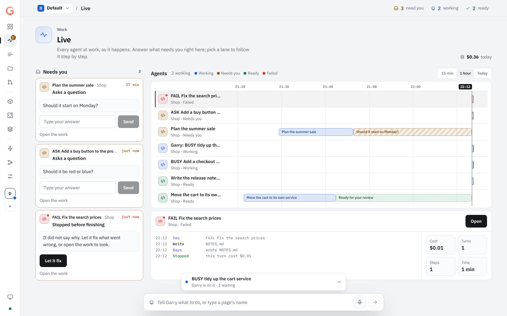

Every page sits in the same frame: a narrow **rail** with every page as an
icon (Live carries a badge with what needs you, your projects are squares to
switch between), a **top bar** with the project, the page and Garry at a
glance (need you, working, ready), and **Garry's field** floating at the foot
of every page. Type, or dictate (the microphone, or **Cmd/Ctrl+J**), and Enter
puts the message in line: Garry works on one message at a time, in one
conversation per repository so it remembers, and sending more never
interrupts the work in progress. What runs, what waits (with its place in
line, and a cross to drop it) and what Garry answered sit just above the
field. **Cmd/Ctrl+K** focuses it; a page's name goes to that page, and the
arrows pick separate work in Build instead. A slash starts a command:
`/remember` (Garry and every agent in the project keep it in mind; see
**Memory**), `/forget`, `/memory`, `/new`, `/pair`, `/stop`, `/help`. Paper by day, graphite by night; colour only ever means a
state. Every page title has its icon, Garry's crew has an icon per role (the
analyst's spec, the developer's code, the reviewer's lens) on a tile in its
state's colour, and empty pages show a picture instead of a blank: sprouts in
the soil when you are caught up, the repository box waiting for a cable. Inputs
and text are sized for long working sessions.

**The feature pipeline** (in Build) shows a feature's orchestration from left
to right, each stage with the agent and model doing it for Garry and for
every service.

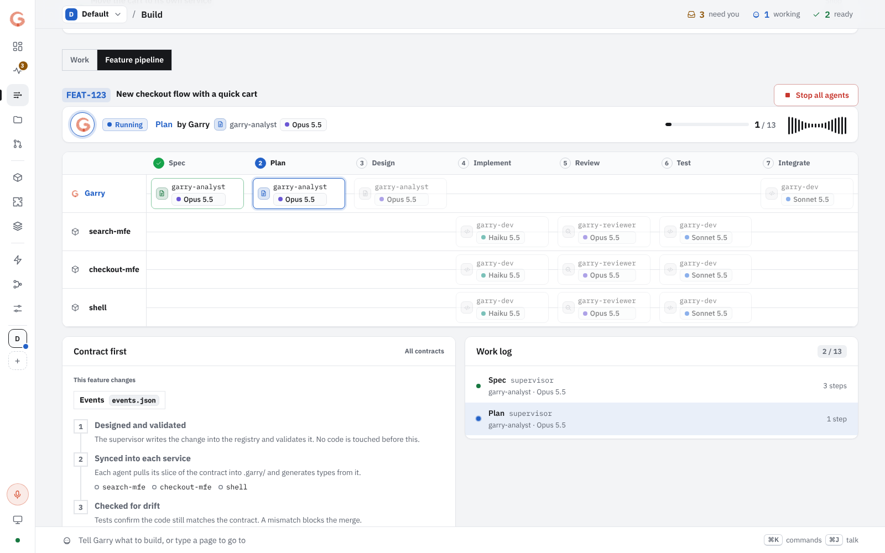

**Architecture**: services and the platforms they run on, joined like puzzle
pieces, on a board for the whole project and one for each repository. The
board takes the whole screen, with its own controls along the top (which
board, the wizard, ready-made architectures, reset). A wizard
builds a board from a few plain questions (who uses it, where it runs, what data
it keeps, what else it needs) and opens again with your answers to change them;
the board stays editable by hand. Logos, relations in words, proxies marked,
ready-made architectures to start from, a reset per board after you confirm, and
Garry saying what is missing. Platforms include AWS, Cloudflare, Vercel,
Supabase, Kubernetes, your own servers (with a reverse proxy), Akamai and Fastly,
and Adobe Experience Manager (AEM Author, AEM Publish, Dispatcher, Adobe CDN,
Edge Delivery Services, Document Authoring, AEM Assets, App Builder, I/O Events).

<picture>
  <source media="(prefers-color-scheme: dark)" srcset="docs/screenshots/architecture-board-dark.png" />
  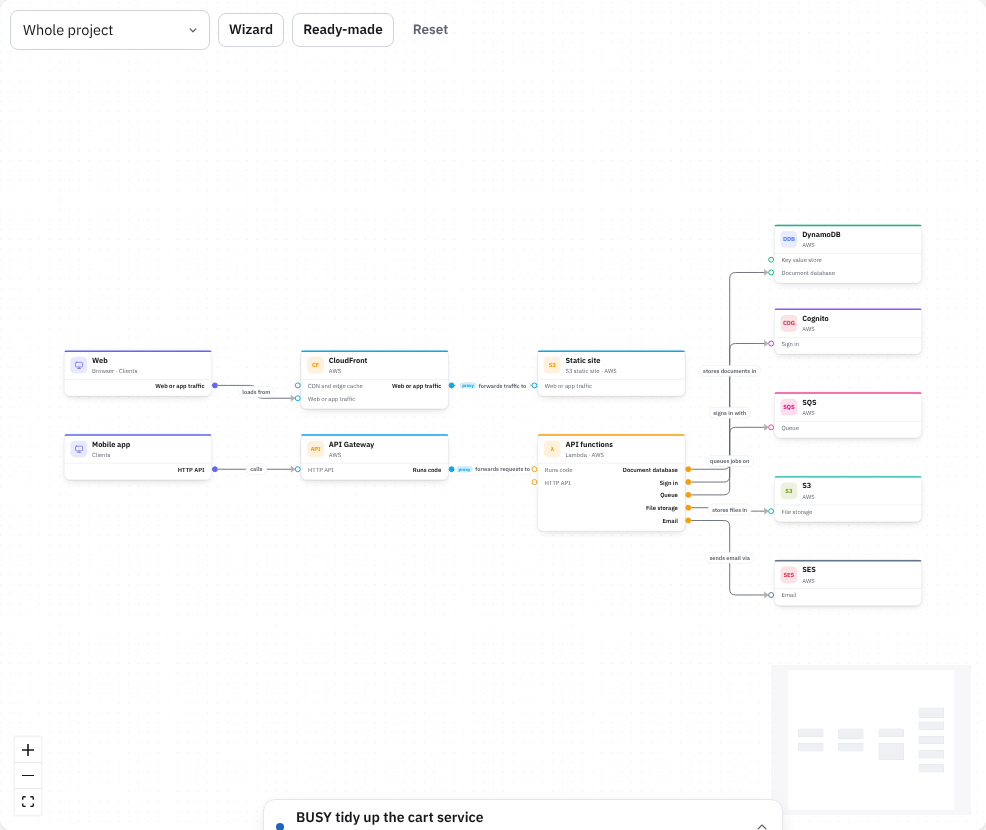
</picture>

The dashboard's menu follows the work: **Work** (Dashboard, Live, Build, Pull
requests) is the idea, the agents building it and what it ships as; **Project**
(Services, Architecture, Stacks, Layers, Files) is what it happens in; **Garry**
(Skills, Model routing, Settings) is how Garry works. Every page uses the whole
width of the screen and works on a phone, where the rail becomes a menu in a
drawer.

<table>
  <tr>
    <td width="50%"><b>Build</b>: describe a change, an agent works on it in its own branch.<br>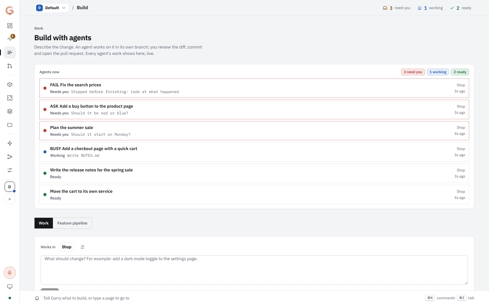</td>
    <td width="50%"><b>A piece of work</b>: the conversation, the diff, commit and pull request.<br>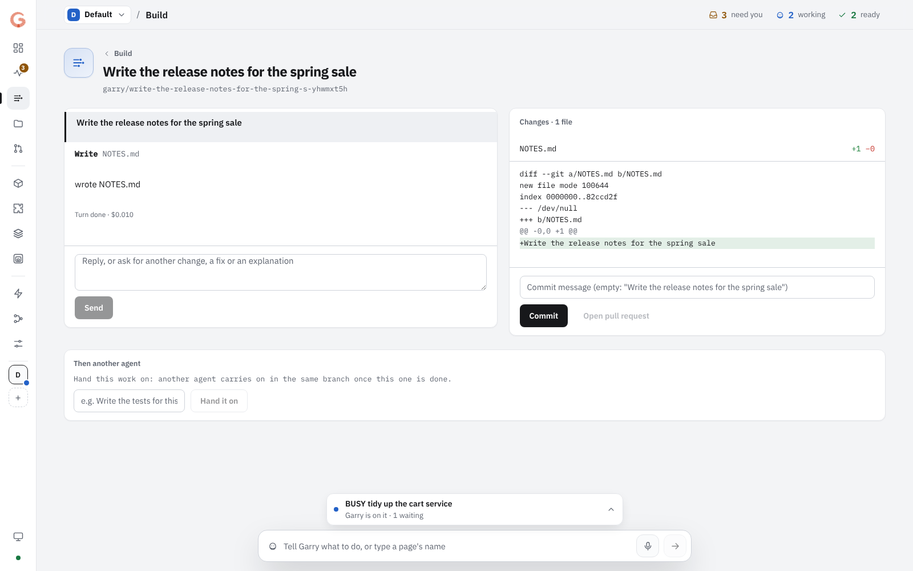</td>
  </tr>
  <tr>
    <td><b>Dashboard</b>: ideas, agents at work, shipped.<br>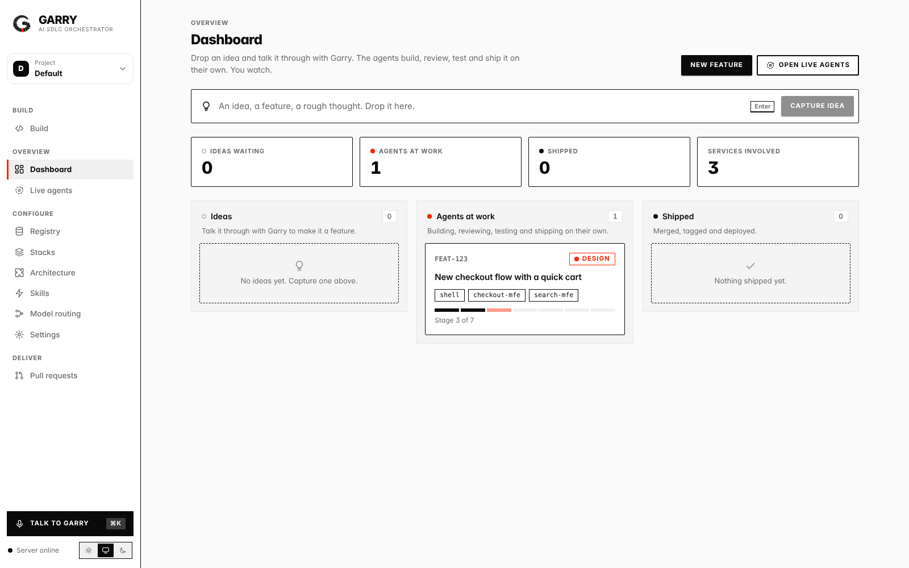</td>
    <td><b>Architecture</b>: the whole page, with the blocks to add.<br>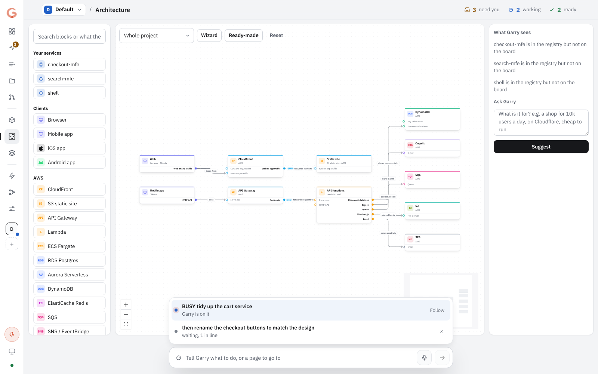</td>
  </tr>
  <tr>
    <td><b>Stacks</b>: the technologies each service is built with.<br>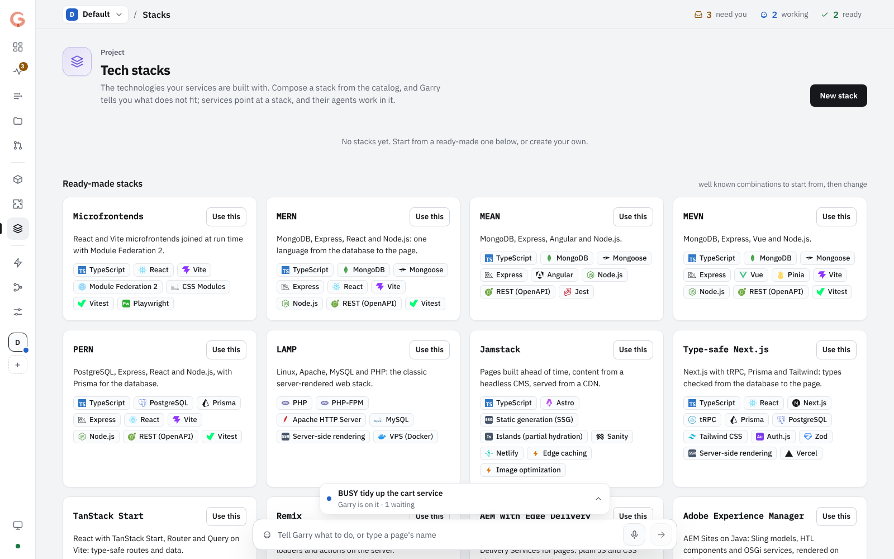</td>
    <td><b>Model routing</b>: which agent and model handle each stage.<br>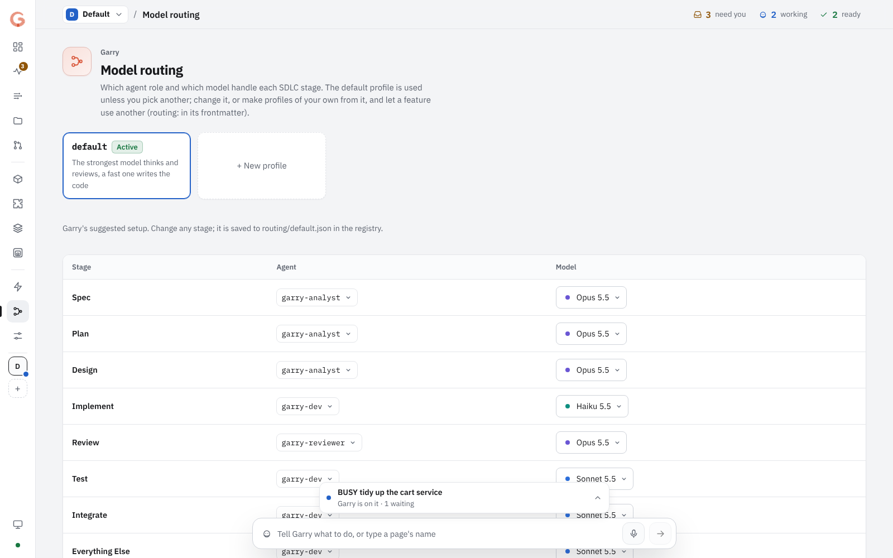</td>
  </tr>
  <tr>
    <td><b>Settings</b>: projects (export and import) and the GitHub connection.<br>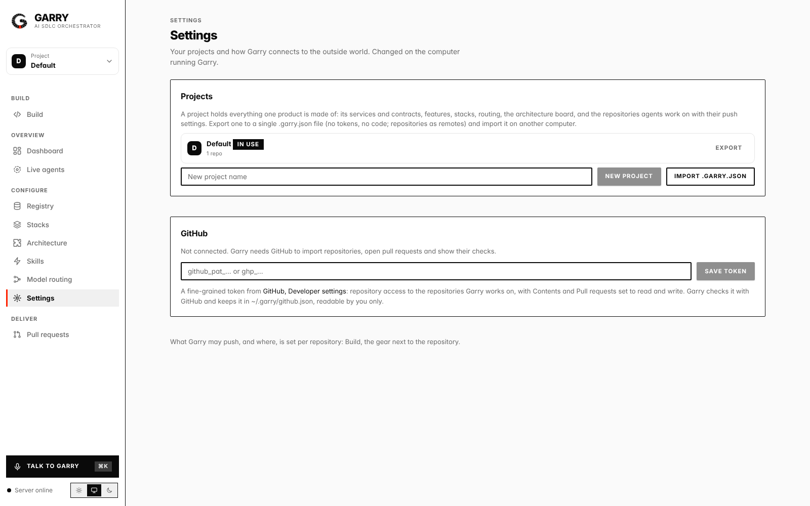</td>
    <td><b>Layers</b>: skills, stacks and notes for the project, a repository or a service, and what an agent ends up with.<br>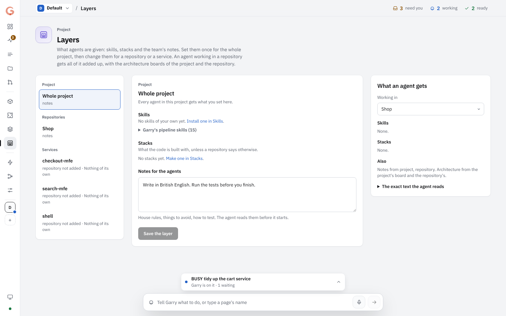</td>
  </tr>
</table>

## Packages

| Package | Role |
|---|---|
| `garry-tool` (`garry` on npm, the only published package) | the `garry` CLI plus the HTTP server (REST and SSE); also the registry schemas and validation (`src/registry/schema`), the pre-installed skills (`skills/`) and the test registries (`testdata/registry`) |
| `garry-ui` | the dashboard (Vite and React), served by `garry serve` |
| `garry-desktop` | the desktop app for macOS (Electron, with `garry serve` built in) |
| `garry-mobile` | the app for iOS (Expo, React Native) |
| `garry-client` | typed client for the server (REST, live stream, pairing), used by the mobile app |

The packages are a pnpm workspace. This repo uses **pnpm only**. The CLI is
published to npm as [`garry`](https://www.npmjs.com/package/garry), with the
registry and skills code bundled in: `npx garry --help`.

## Quick start

```bash
pnpm install
pnpm dev
```

`pnpm dev` starts the whole app for development: the server on
http://localhost:8123 and the UI with hot reload on http://localhost:3000.

Garry starts empty: there is no sample data. Add your services in the dashboard
(Services, Add service) or with `garry service add`, optionally on a tech stack
you compose first (Stacks, or `garry stack add`), and lay out how they fit together
with the platforms they run on (Architecture); they go to `./registry` when
it has a `catalog/`, else to `~/.garry/registry`. Then create a feature (New
feature on the dashboard or the phone, or Make it a feature on a captured idea,
or `garry feature new`) and watch its pipeline.

Without development tools, `pnpm -C garry-ui build` once and `pnpm serve`: the
server hosts the dashboard and the API together on http://localhost:8123 (the npm
package ships the dashboard built, so `npx garry serve` does the same).

Configuration is optional: copy [`.env.example`](./.env.example) to `.env.local`
and fill in what you need. GitHub needs no file at all: paste a token in Settings
(GitHub) or with `garry github login`, or sign in with the GitHub CLI.

## Projects

Everything one product is made of (services, contracts, features, stacks,
routing, the architecture board, and the repositories agents work on) lives in
a Garry project. Switch projects at the top of the sidebar; export one to a
single `.garry.json` file and import it on another computer (Settings,
Projects, or `garry project export` / `import`). See [docs/cli-more.md](./docs/cli-more.md#garry-project).

## Layers: what agents are given

What an agent knows about your project comes in layers: **project > repository
> service**. Skills, stacks and the team's notes are set once for the project,
changed per repository and added to per service. An agent gets the sum of the
layers, along with the architecture boards. Skills can be installed for one
project, repository or service. See [docs/layers.md](./docs/layers.md).

## Build with agents (the IDE)

Garry is where you work on code with agents. Open **Build** in the dashboard, the
desktop app or the phone app. **Start a job**: pick the repository, say what
should change, and choose who works on it. **Your jobs** lists every job in one
list, what needs you first, with filters (needs you, working, ready to review,
done). Adding a repository and the feature pipeline are buttons in the header.

- every piece of work gets its own branch and git worktree
  (`garry/<what>-<id>`), so your own checkout is never touched;
- you follow the agent live: what it reads, edits and runs, and its answers; you
  reply to steer it, or stop it;
- the diff shows everything it changed; **Commit**, then **Open pull request**
  (CI, the AI review and screenshots take it from there, and when the change
  needs a person to try it, the pull request gets the **needs human QA** label and
  a checklist of what to check). Garry asks before every push, showing the
  branch, the remote and the commits; each project can change that (ask, allow,
  never), its base branch, branch prefix and protected branches (Push and branch
  settings), and agents themselves can never push. A repository not on GitHub
  yet gets one named as it is in Garry (private, yours or an organization's),
  created only when you say yes, before the pull request or from its settings;
- **Files** (its own tab) works like a code editor: an explorer of the registry,
  each repo and each piece of work in progress, files open in tabs, Cmd/Ctrl+S
  saves, and a terminal along the bottom (Ctrl+`) opens a shell in that folder.
  Your edits land in the same diff. A worktree is read only while its agent
  works, and a file changed on disk since you opened it is not overwritten. A
  changed file in a piece of work's diff opens straight in Files. Files and the
  terminal open on this computer only, never on a paired phone; a company can
  turn the terminal off with `GARRY_TERMINAL=off`.

Who works on a job:

- **One agent**: it makes the change on its own branch.
- **Agent and reviewer** (a pair): one agent writes; each time it finishes, a
  reviewer agent reads its changes and answers APPROVED, or CHANGES with what
  to fix. The writer gets the fixes as its next message and the reviewer looks
  again, up to the number of rounds you pick (1 to 5); out of rounds, or when
  the writer asks you something, the pair waits for you.
- **Several steps** (a chain): steps in the order you set, each its own agent,
  the next starting when the one before is done and building on its work.
  Steps that have not started can be moved, dropped and added to (Build, Your
  jobs), a chain can be stopped after the step that runs, and any piece of work can be handed on to another agent
  from its own page (**Then another agent**). A step that asks you something
  pauses the chain until your answer's turn ends well.

Live shows every agent of a pair or chain as its own lane, the reviewer with
the reviewer's icon.

The agent is [Claude Code](https://docs.claude.com/en/docs/claude-code) on your
own Claude plan, run on the computer that runs Garry: install it and sign in once
(`claude`). No API key is needed. It may read, edit and write files in the
worktree and run read-only git commands; anything else it asks for is refused for
now (approving commands is the next step).

Projects are git repositories on that computer: `garry serve` adds the one it
starts in, the desktop app adds the folder you open, and `garry repos add
<path>` adds others. Your phone can start and steer work once it is paired, but
only this computer can add folders, open and edit files, or discard work.

## Platforms

The apps ship for **macOS** and **iOS** for now, where Touch ID and Face ID guard
them. The `garry` CLI and the dashboard in the browser run on macOS, Windows and
Linux, and the iPhone app pairs with a Garry server on any of them. Windows,
Linux and Android apps (and biometrics there):
[#19](https://github.com/piotrgodycki/garry/issues/19).

## Desktop app

`garry-desktop` is Garry as an app for macOS: the dashboard in
its own window with the server built in, so there is nothing else to install or
start. File, Open Project picks the folder with your registry; Devices, Allow Phones
and Other Computers, then Pair a Device, shows the pairing QR code.

- Installers: every release attaches them to its
  [GitHub release](https://github.com/piotrgodycki/garry/releases): `.dmg` for macOS
  (Apple silicon and Intel).
  Actions, Desktop, Run workflow builds them for any commit as a workflow artifact.
- **Touch ID** (Macs with Touch ID): the app opens locked, locks again when the
  screen locks, the Mac sleeps or after ten idle minutes (or Devices, Lock Garry),
  and asks for Touch ID before it starts new work, commits or opens a pull request.
  Devices, Require Touch ID turns it off (with Touch ID).
- **In the menu bar**: Garry's G shows whether an agent is working (moving
  dots), needs you (! with how many beside it: a question at the end of its
  turn, or it stopped) or has work ready for review (a tick). Its menu lists
  the work and opens it; notifications say when something becomes ready or
  needs you, and the Dock icon carries the count. The same status is
  `GET /api/status`.
- From source: `pnpm desktop` builds the app and starts it (Electron is downloaded
  on the first run).
- The installers are not code signed yet. macOS then says the app "cannot be
  opened": right click it, Open, or run `xattr -cr /Applications/Garry.app`.
  Signing starts as soon as
  the `CSC_LINK` and `CSC_KEY_PASSWORD` secrets (and for macOS notarization
  `APPLE_ID`, `APPLE_APP_SPECIFIC_PASSWORD`, `APPLE_TEAM_ID`) are set.

## Mobile app

`garry-mobile` is Garry on your phone, in the same look as the dashboard. Its
home screen starts with what needs you, in the agent's own words, answered
right there (or **Let it fix** for an agent that stopped; sprouts in the
soil when nothing waits), then the agents at work with their icons and
states, then the features and the stage each is at. A feature shows its work
log and its pull requests; a piece of work shows the conversation, its
changes, commit and pull request. New feature creates one (what it is,
the goal, the services and contracts it touches), New work starts an agent in a
project. It talks to the server on your
computer over your Wi-Fi (or Tailscale), after pairing once with a QR code.

1. On the computer: `pnpm serve --host 0.0.0.0` (or `garry serve --host 0.0.0.0`),
   or in the desktop app Devices, Allow Phones and Other Computers. A pairing QR
   code is shown; `garry pair` shows a new one.
2. Run the app: install **Expo Go** from the App Store, then `pnpm mobile` on the
   computer and scan the QR code it prints with the camera. The phone must be on
   the same network.
3. In the app, scan Garry's pairing QR code. The phone gets its own key, kept in
   the iOS keychain; `garry devices revoke <id>` cuts it off.

Face ID, notifications on the iPhone and App Store builds: [docs/mobile.md](./docs/mobile.md).

<table>
  <tr>
    <td width="50%">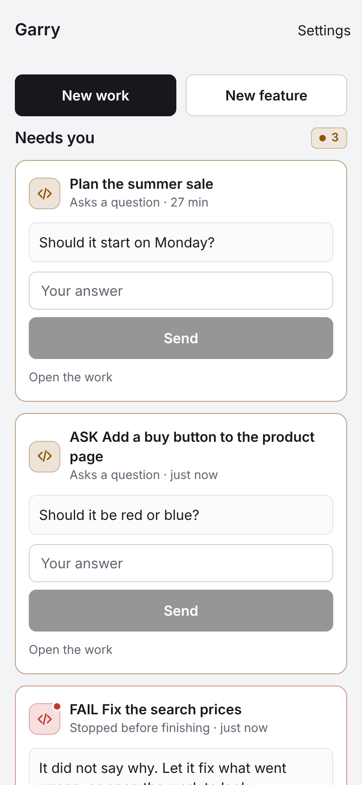</td>
    <td width="50%">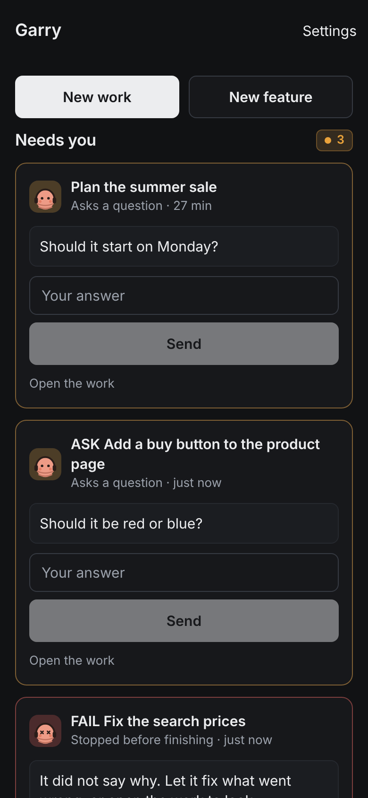</td>
  </tr>
</table>

## Guides

- [The Garry SDLC](./docs/sdlc.md): how a feature goes from an idea to production,
  stage by stage, and what you do at each one.
- [The garry CLI](./docs/cli.md): every command with its options and examples.

## Commands

| Command | What it does |
|---|---|
| `pnpm dev` | start the server and the UI together |
| `pnpm serve` | server only, on :8123 |
| `pnpm ui` | UI only with hot reload, on :3000 (needs the server) |
| `pnpm desktop` | build and start the desktop app |
| `pnpm mobile` | start the mobile app for Expo Go (scan the QR code with your phone) |
| `pnpm garry repos` | the repositories of the active project (`add <path>` adds one) |
| `pnpm scaffold` | the interactive scaffolding wizard |
| `pnpm -r typecheck` | type check every package |
| `pnpm -C garry-tool check:registry <dir>` | validate a registry (for example `testdata/registry/frontend`) |
| `pnpm -C garry-tool check:skills` | validate the skills manifest |
| `pnpm -C garry-tool readme-shots` | retake the README's screenshots (after `pnpm -C garry-ui build` and `pnpm -C garry-mobile export:web`) |

## Continuous integration and security

Every push and pull request runs the checks in
[`.github/workflows/ci.yml`](./.github/workflows/ci.yml): typecheck, the registry
and skills, the browser tests of the dashboard and the iPhone app, the package,
the dash guard and a security review. How each works, publishing to npm, how
skills reach the team, the AI review and the screenshots on pull requests:
[docs/ci.md](./docs/ci.md). How Garry keeps your code, tokens and devices safe:
[docs/security.md](./docs/security.md).

## Keeping files small for agents

Agents read whole files; past about 5,000 tokens they skim, miss things and
edit the wrong place. A pre-commit hook refuses a staged file over 5,000 tokens
(counted as bytes / 4) and says how to split it; lockfiles, generated code and
binaries are left alone. It runs in this repository (`pnpm install` turns it
on), Garry runs the same check before it commits an agent's work in your
projects (Build, the project's settings, 0 turns it off), and
`garry hooks install` adds it to any repository. See
[docs/cli-more.md](./docs/cli-more.md#garry-hooks).

## Conventions

- English only, with plain ASCII punctuation. No em dashes. The dash guard enforces
  this in CI.
- Contract first: nothing touches code until the contract in the registry is updated
  and validated.
- One Garry: the worm's shape lives in `garry-ui/app/GarryMark.tsx`; the logo, the
  favicon and the Mac and iPhone app icons are drawn from it by
  `pnpm -C garry-tool brand`, and CI fails if a committed one differs.

## License

[MIT](./LICENSE). Contributions are accepted under the same license.
